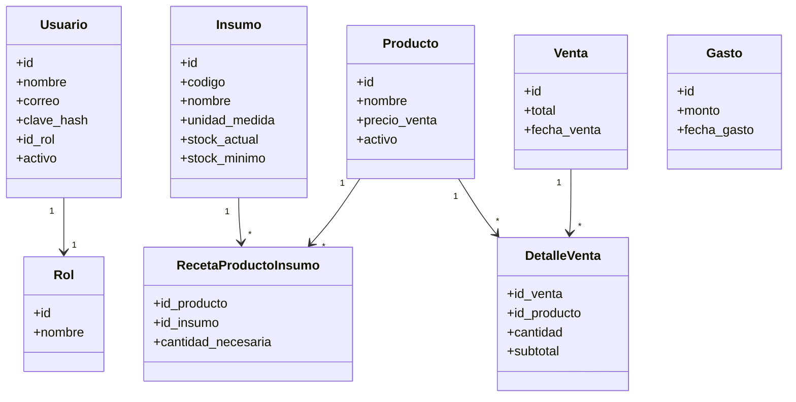
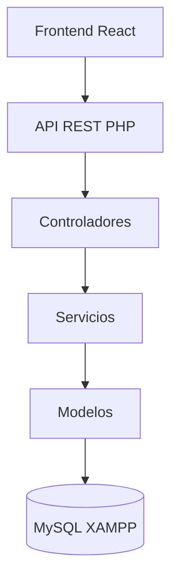
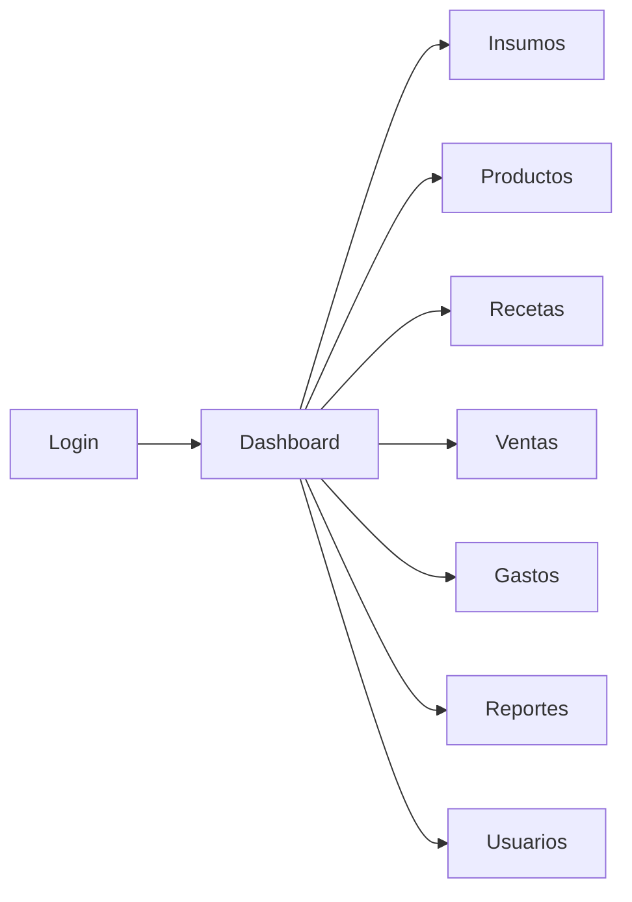

# Diagramas del Sistema

## 1. Diagrama de Paquetes
```mermaid
packageDiagram
  class frontend {
    <<react>>
    pages/
    components/
    services/
    hooks/
    contexts/
    utils/
  }
  
  class backend {
    <<php>>
    config/
    controllers/
    services/
    models/
    helpers/
  }
  
  frontend --> backend : HTTP/REST
  backend --> db : PDO/MySQL
```

## 2. Diagrama de Clases (Simplificado)


## 3. Diagrama de Componentes


## 4. Mapa de Navegación


## 5. Arquitectura por Capas
- **Capa Presentación**: React (Vistas + Componentes)
- **Capa Negocio/Lógica**: PHP Services
- **Capa Datos**: PHP Models + PDO
- **Capa Configuración**: db.php
- **Persistencia**: MySQL

## 6. Seguridad (Mecanismos)
- Autenticación por sesiones PHP
- Hash de contraseñas (password_hash/password_verify)
- Validación servidor + cliente
- Prepared statements (PDO)
- Control por roles (middleware por ruta)
- CORS configurado (desarrollo)
